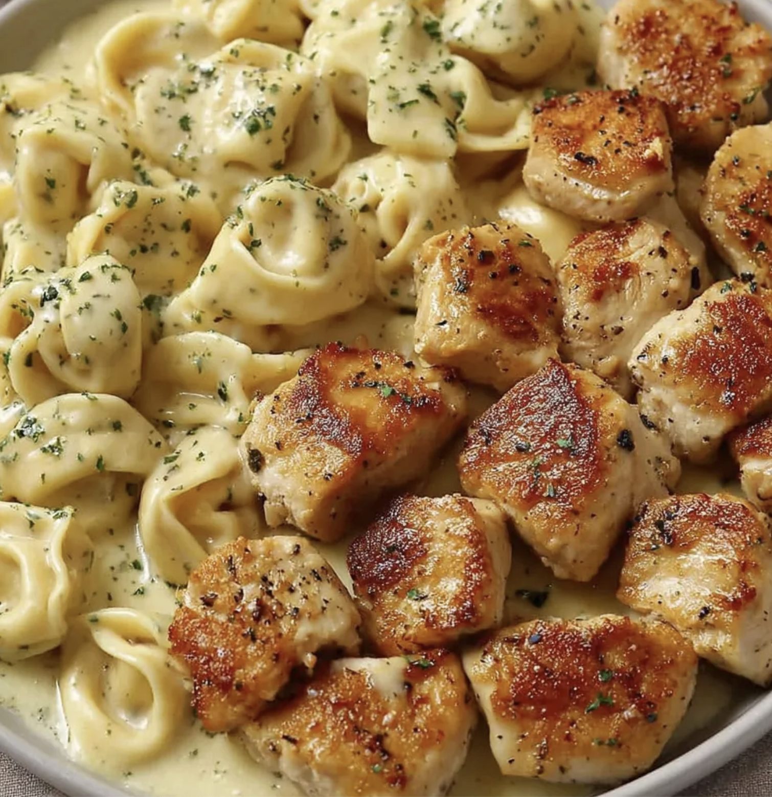

# Курячі Bites з равіолі під соусом Arla та сиром

### 🛒 Інгредієнти

- **Куряче філе:** 1-2 шт. (350-400 г)
- **Cheese Tortellini (such as Barilla):** 1 упаковка (250 г)
- **Крем-сир (типу Філадельфія):** 150 г
- **Сир (Cheddar or Mozzarella):** 100–120 г
- **Вершкове масло:** 1 ст. л.
- **Часник:** 2–3 зубчики
- **Спеції:** паприка (1 tsp), сіль (to taste), чорний перець (to taste)
- **Зелень:** свіжа петрушка - a few sprigs (for garnish)

---

### 🥣 Процес приготування

**1. Підготовка компонентів:**

- **Відвари 250 г Tortellini** у киплячій воді на **2 хвилини МЕНШЕ**, ніж вказано на пачці (щоб були пружними).
- **Важливо:** набери кружку води **50-80 мл, у якій вони варилися**, перш ніж зливати.

> Куряче філе

- Нарізати **кубиками 2х2** см **Куряче філе**
- **Розтопи** в мікрохвильовці 1 ст. л. **вершкового масла** і додай у форму для запікання
- Додай 1 ст. л. **оливковоі оліі**
- **Додай шматки філе**, перемішай
- **посоли, поперчи**
- додай **паприку**
- **Перемішай**

**2. Перший етап в аерогрилі (Курка):**

- Готуй **10 хвилин при 200°C**.
- **Перемішай** в середені запікання
- Курка має стати золотистою, але залишитися соковитою всередині.

**3. Збирання соусу (прямо у формі для запікання):**

- Подрібни 2 зубчики часнику
- Натри на **крупній** терці **Сир:** 100–120 г
- Поклади в форму **150–200 г крем-сиру**
- подрібнений **часник**
- додай приблизно 80–100 мл гарячої **води від Tortellini**
- Ретельно **розмішай** ложкою до однорідного кремового стану.
- Додай **дрібку перцю**.

**4. Об'єднання:**

- Додай у форму **відварені Tortellini**
- Обережно **перемішай**, щоб кожен Tortellini був вкритий соусом.
- Рясно засип усе зверху **тертим сиром**.

**5. Фінальне запікання:**

- Постав форму в аерогриль.
- Запікай **5–7 хвилин при 180°C**, поки сир не розплавиться і не з'являться характерні золотисті «острівці» запеченого сиру.

**6. Подача:**

- Дай страві «відпочити» 2 хвилини (соус трохи загусне).
- Посип свіжою зеленню (петрушки)

image: https://res.cloudinary.com/bttfno8p/image/upload/v1792774742/Chicken-Bites-Tortellini.jpg

---

---

---

# 💡 Зйомка

> равіолі

- **Відвари 250 г равіолі** у киплячій воді на **2 хвилини МЕНШЕ**, ніж вказано на пачці (щоб були пружними).
- **Важливо:** набери кружку води **50-80 мл, у якій вони варилися**, перш ніж зливати.

> Куряче філе

- **Розтопи** в піалі 1 ст. л. **вершкового масла** в мікрохвильовці.

У силіконову форму додай:

- розтоплене **вершкове масло**
- Додай 1 ст. л. **оливковоі оліі**
- Нарізати **кубиками 2х2** см **Куряче філе:** 2 невеликих шт
- **Додай шматки філе**, перемішай
- **посоли, поперчи**
- додай **паприку**
- **Перемішай**

**2. Перший етап в аерогрилі (Курка):**

- Готуй **10 хвилин при 200°C**.
- **Перемішай** в середені запікання
- Курка має стати золотистою, але залишитися соковитою всередині.

**3. Збирання соусу (прямо у формі для запікання):**

- Подрібни 2 зубчики часнику
- Поклади в форму **150–200 г крем-сир Arla**
- подрібнений **часник**
- додай приблизно 80–100 мл гарячої **води від равіолі**
- Ретельно **розмішай** ложкою до однорідного кремового стану.
- Додай **дрібку перцю**.

**4. Об'єднання:**

- Додай у форму **відварені равіолі**
- Обережно **перемішай**, щоб кожен равіолі був вкритий соусом.
- Натри на **крупній** терці **Сир Regato:** 100–120 г
- Рясно засип усе зверху **тертим Regato**.

**5. Фінальне запікання:**

- Постав форму в аерогриль.
- Запікай **5–7 хвилин при 180°C**, поки Regato не розплавиться і не з'являться характерні золотисті «острівці» запеченого сиру.

**6. Подача:**

- Дай страві «відпочити» 2 хвилини (соус трохи загусне).
- Посип свіжою зеленню (петрушка або базилік)

---

200-10
180-7
